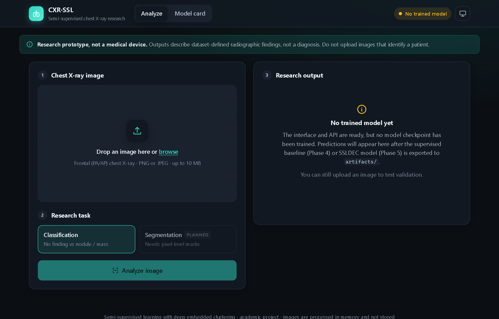
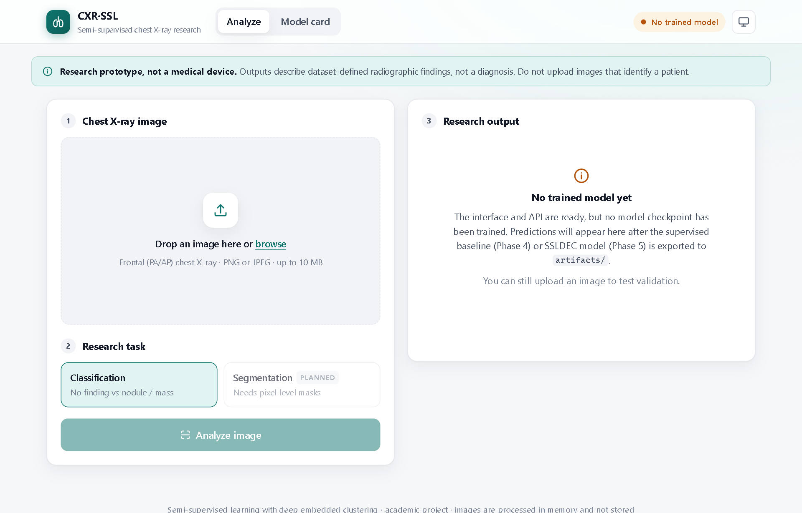
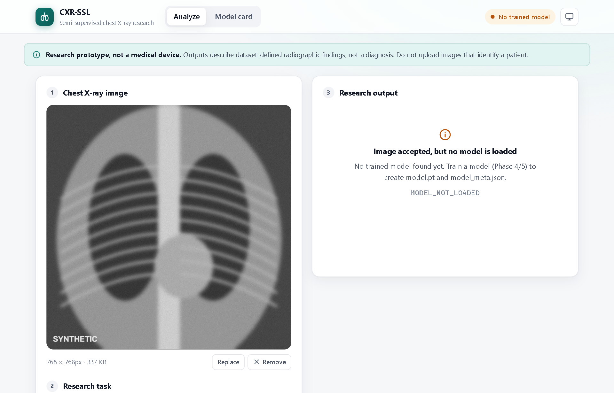
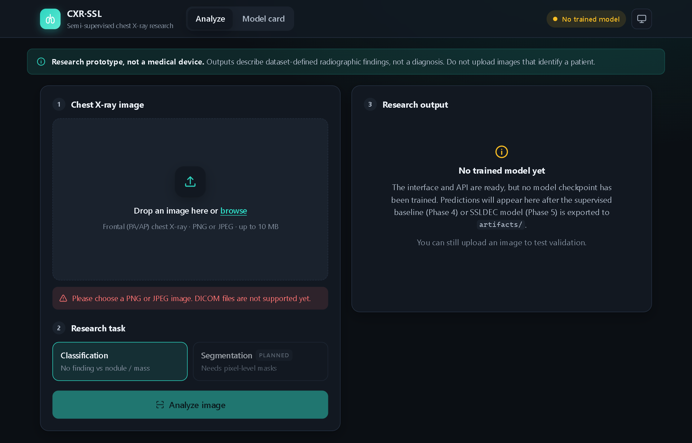
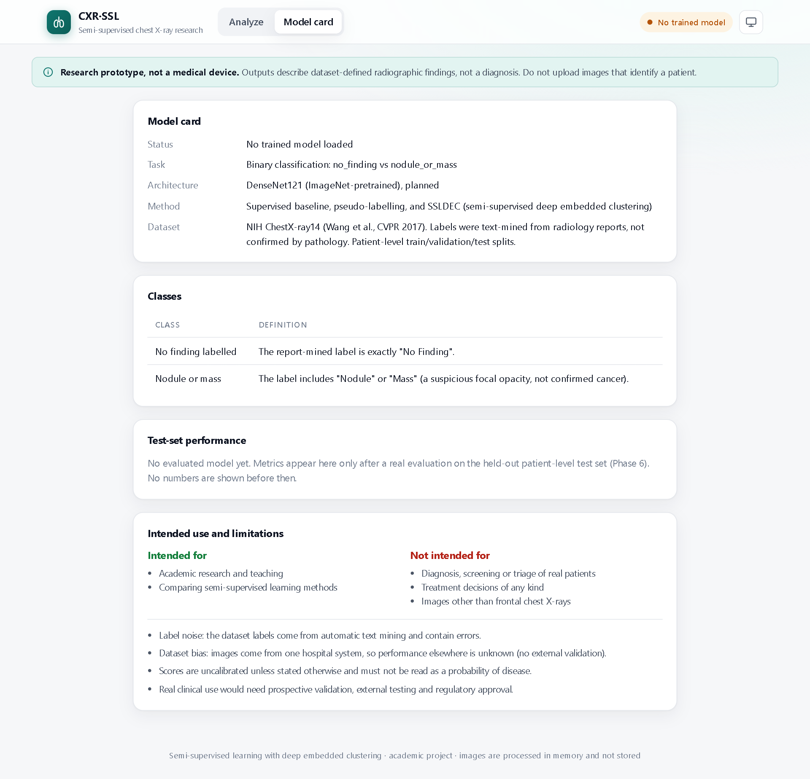
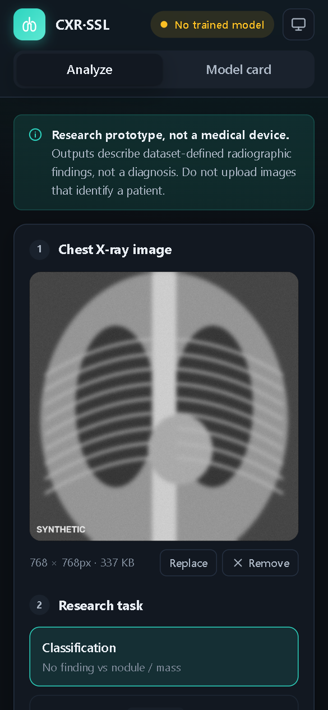

# medical-ssl-dec

Semi-supervised chest X-ray classification with Deep Embedded Clustering
(SSLDEC, Enguehard et al., IEEE Access 2019), compared against supervised-only
and pseudo-labelling baselines, served via a FastAPI + React research prototype.

> **Research prototype. Not a medical device.** Outputs are model scores for
> radiographic findings defined by report-mined dataset labels. They do not
> diagnose cancer or any disease and must not guide clinical decisions.

## Screenshots

The images below use a **synthetic** X-ray-like picture, never patient data.
No model has been trained yet, so the app shows its honest "no model" states;
prediction screenshots will be added after Phase 4/5.

| Analyze page (dark theme) | Analyze page (light theme) |
|---|---|
|  |  |
| **Upload accepted and validated** | **Invalid file rejected** |
|  |  |

| Model card | Mobile |
|---|---|
|  |  |

Regenerate with both servers running:
`cd frontend && node scripts/screenshots.mjs <synthetic.png> <any-non-image-file>`
(uses your installed Microsoft Edge through `playwright-core`).

## Status

| Phase | State |
|---|---|
| 1 Planning | done: [docs/phase1_planning.md](docs/phase1_planning.md) |
| 2 Environment | scaffold done; local setup pending |
| 3 Data | code written and tested on synthetic data; real data not downloaded |
| 4-6 Models | baseline, pseudo-labelling, SSLDEC, evaluation and comparison code written and tested on synthetic data; not yet trained on real data |
| 7 Web app | UI + API built and tested; waiting for a trained model |
| 8 | not started |

No experimental results exist yet.

## Project layout

```
configs/config.yaml     all paths and hyperparameters
data/raw/               original dataset files (git-ignored)
data/processed/         resized training copies (git-ignored)
data/splits/            patient-level split CSVs (IDs only, committed)
scripts/                command-line entry points (check_env, prepare, train...)
src/data/               dataset classes, preprocessing, splitting
src/models/             backbone, DEC layer, SSL model, U-Net
src/training/           training loops and losses
src/evaluation/         metrics and plots
src/utils/              config loading, seeding, logging
backend/                FastAPI app (Phase 7)
frontend/               React + Vite app (Phase 7)
tests/                  pytest suite
experiments/            per-run logs/metrics (git-ignored)
artifacts/              exported best models for inference (git-ignored)
docs/                   planning and report material
```

## Environment setup

Python 3.11-3.14 (the reference machine uses 3.14; Colab uses 3.12). PyTorch
is installed separately from `requirements.txt` because the wheel depends on
your CUDA version. Get the current command from
https://pytorch.org/get-started/locally/. The cu126 wheels work with NVIDIA
drivers that support CUDA 12.x; cu130 needs a newer driver.

### Windows

```powershell
# keep caches and pip temp files off a full C: drive
setx PIP_CACHE_DIR "F:\cache\pip"
setx TORCH_HOME "F:\cache\torch"
# (open a NEW terminal so the variables take effect)

cd F:\project
python -m venv .venv
.venv\Scripts\activate.bat          # Command Prompt
# .\.venv\Scripts\Activate.ps1      # PowerShell
python -m pip install --upgrade pip
pip install torch torchvision --index-url https://download.pytorch.org/whl/cu126
pip install -r requirements.txt
python scripts/check_env.py
```

### Linux

```bash
python3.12 -m venv .venv && source .venv/bin/activate
pip install --upgrade pip
pip install torch torchvision          # default Linux wheel includes CUDA
pip install -r requirements.txt
python scripts/check_env.py
```

### Google Colab

```python
# Runtime > Change runtime type > GPU
!git clone https://github.com/<your-user>/medical-ssl-dec.git
%cd medical-ssl-dec
!pip install -q -r requirements.txt     # torch is preinstalled on Colab
!python scripts/check_env.py
```

## Data preparation (Phase 3)

1. Open the official NIH folder https://nihcc.app.box.com/v/ChestXray-NIHCC in a
   browser and read its README for the usage terms and required citation.
2. Download into `data/raw/chestxray14/`:
   - the metadata CSV (`Data_Entry_2017.csv`; if the folder only has a
     versioned name such as `Data_Entry_2017_v2020.csv`, set
     `data.metadata_csv` in `configs/config.yaml` to that name)
   - `train_val_list.txt` and `test_list.txt`
   - the 12 image archives in `images/` (`images_001.tar.gz` ... `images_012.tar.gz`)
3. Extract the archives in place (Windows 10+ has `tar` built in):
   ```powershell
   cd F:\project\data\raw\chestxray14
   Get-ChildItem images_*.tar.gz | ForEach-Object { tar -xzf $_.Name }
   ```
   The scripts find PNGs anywhere under `raw_dir`, so the folder layout does not matter.
4. Validate, resize, and split:
   ```powershell
   python scripts/prepare_images.py --limit 500   # trial run first
   python scripts/prepare_images.py               # full run (resumable)
   python scripts/make_splits.py
   python -m pytest -q tests
   ```

## Training and evaluation (Phases 4-6)

After `make_splits.py` (virtual environment active):

```
python scripts/train.py --method baseline
python scripts/train.py --method pseudo_label
python scripts/train.py --method ssldec
```
Options: `--labeled-fraction 0.01|0.05|0.10|0.25` (default 0.05), `--seed N`,
`--overwrite`. Each run writes `experiments/<method>_lab<XX>_seed<S>/` with
`best.pt`, `history.csv`, `val_metrics.json` and `train.log`. Training never
reads the test set; model selection and the decision threshold use validation only.

When all training and tuning are finished, evaluate on the test set **once**:
```
python scripts/evaluate.py experiments/baseline_lab05_seed42 experiments/pseudo_label_lab05_seed42 experiments/ssldec_lab05_seed42
python scripts/compare_results.py          # tables + figures in results/
python scripts/export_model.py experiments/ssldec_lab05_seed42   # serve in the web app
```

| Method | What it does | Code |
|---|---|---|
| Supervised baseline | DenseNet121 + linear head, labelled images only, class-weighted CE | `src/training/supervised.py` |
| Pseudo-labelling | warm-up, then rounds of confident (≥0.95), prior-balanced pseudo-labels | `src/training/pseudo_label.py` |
| SSLDEC | embedding + Student's t clusters (one per class), centres = labelled class means, `L_sup + λ(t)·KL(P‖Q)` on confident unlabelled images, prior-corrected targets | `src/training/ssl_training.py`, `src/models/dec.py` |

If CUDA runs out of memory, set `training.batch_size: 16`. If DataLoader
workers crash on Windows, set `training.num_workers: 0`.

## Running the web app

Requires Node.js 20+ (for the frontend) and the Python environment above.
Use two terminals, both started in the project folder.

**Terminal 1: backend (FastAPI, port 8000)**
```
.venv\Scripts\activate.bat
uvicorn backend.main:app --reload --port 8000
```
Check it: http://localhost:8000/api/health and the interactive API docs at
http://localhost:8000/docs

**Terminal 2: frontend (React + Vite, port 5173)**
```
cd frontend
npm install        # first time only
npm run dev
```
Open http://localhost:5173. Vite forwards `/api/*` to the backend, so no CORS
setup is needed in development.

Until a model is trained, the UI shows "No trained model" and `/api/predict`
returns `503 MODEL_NOT_LOADED` after validating the upload. Training scripts
(Phase 4/5) export `artifacts/model.pt` + `artifacts/model_meta.json`
(format documented in `backend/services/predictor.py`); restart the backend to
load them.

### API contract

| Method | Path | Response |
|---|---|---|
| GET | `/api/health` | `{"status": "ok"}` |
| GET | `/api/model/status` | `ModelStatus`: loaded, message, task, classes, model_version, score_type, metrics, max_upload_mb |
| POST | `/api/predict` (multipart field `file`, PNG/JPEG) | `PredictionResponse`: predicted_label, scores[], score_type, threshold, model_version, inference_ms, disclaimer |

Errors always use `{"error": {"code", "message"}}`, with these codes:
`UNSUPPORTED_TYPE` (415), `FILE_TOO_LARGE` (413), `EMPTY_FILE` / `INVALID_IMAGE` (400),
`INVALID_REQUEST` (422), `MODEL_NOT_LOADED` (503), `INTERNAL_ERROR` (500).
Schemas: `backend/schemas.py`, mirrored in `frontend/src/types.ts`.

Tests: `python -m pytest -q -m "not slow"` (fast), `python -m pytest -q` (adds
end-to-end training smoke tests, a few minutes on CPU) and `cd frontend && npm test`.

## Deployment

### Frontend on Vercel

The React app is static and deploys to Vercel's free tier. Config: `frontend/vercel.json`.

1. Sign in at https://vercel.com with GitHub.
2. **Add New → Project →** import `-medical-ssl-dec`.
3. Set **Root Directory** to `frontend`. Vercel detects Vite (build `npm run build`, output `dist`).
4. Optional: under **Environment Variables** add
   `VITE_API_BASE = https://<your-backend-host>/api` (see below).
5. **Deploy.** Every `git push` to `main` redeploys automatically.

Without a backend the hosted page shows "Analysis server is offline". The
upload UI, model card and disclaimers still work.

### Backend (not on Vercel)

The FastAPI backend needs PyTorch (~2.5 GB installed). That is far over
Vercel's serverless function size limit, so host it elsewhere, for example:

| Host | Free tier | Notes |
|---|---|---|
| Hugging Face Spaces (Docker) | CPU, 16 GB RAM | best free fit for PyTorch inference |
| AWS EC2 | free tier `t3.micro` is too small for DenseNet; use a larger paid instance | full control (Phase 8) |
| Local machine | free | for demos and the viva |

Then set on the backend `CORS_ORIGINS=https://<your-app>.vercel.app`, and on
Vercel `VITE_API_BASE=https://<backend>/api`, and redeploy. A Dockerfile for the
backend comes in Phase 8.

## Data and privacy rules

- Never commit images, masks, checkpoints, or secrets (enforced by `.gitignore`).
- The test split is fixed and is used only for final evaluation.
